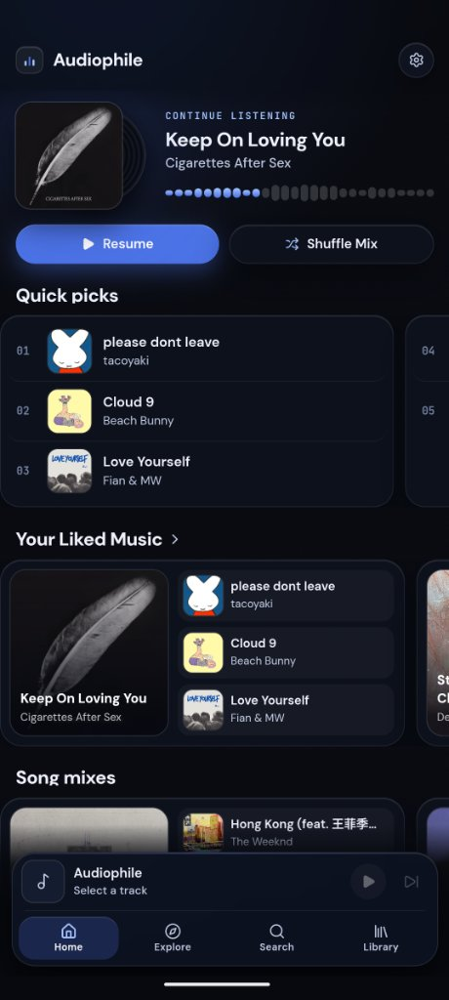
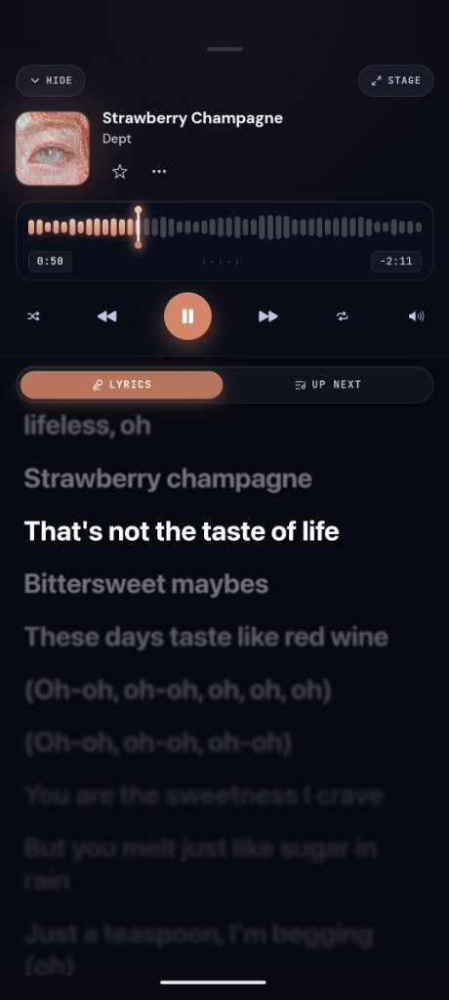
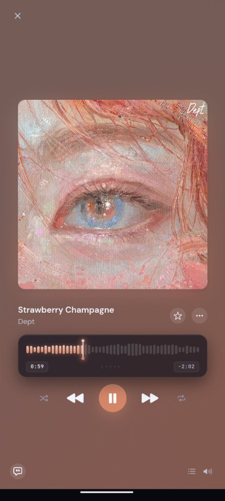
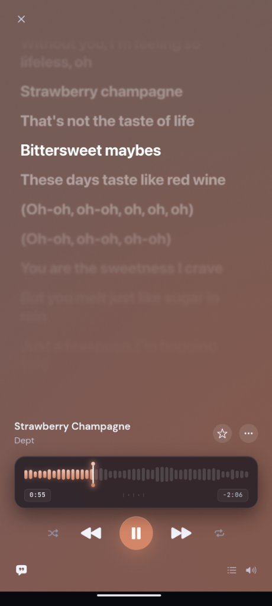
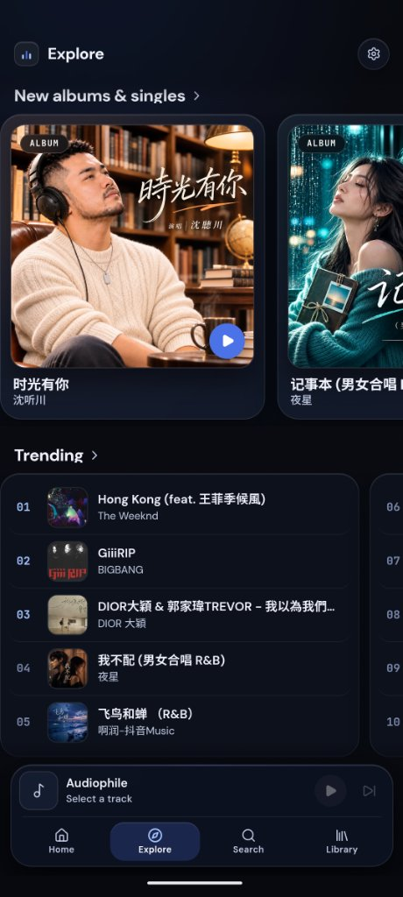
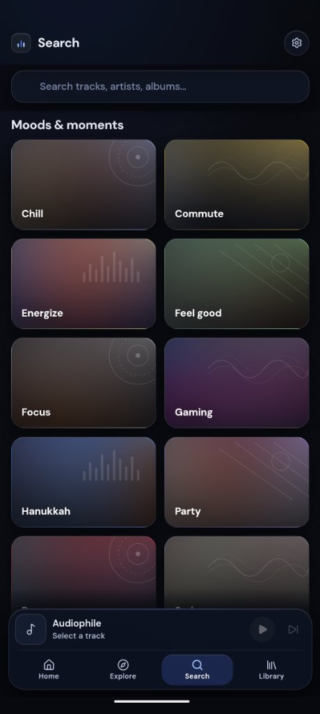
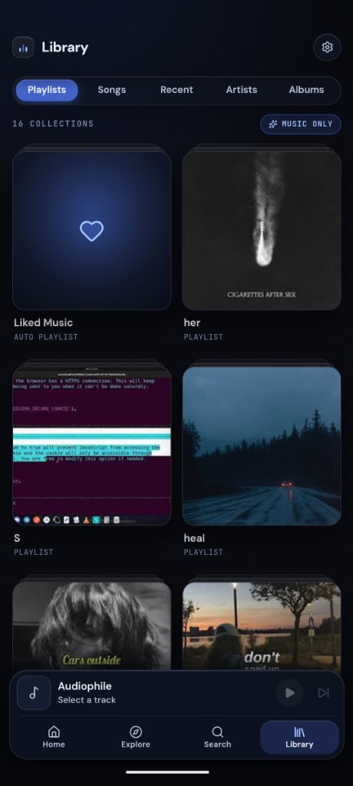
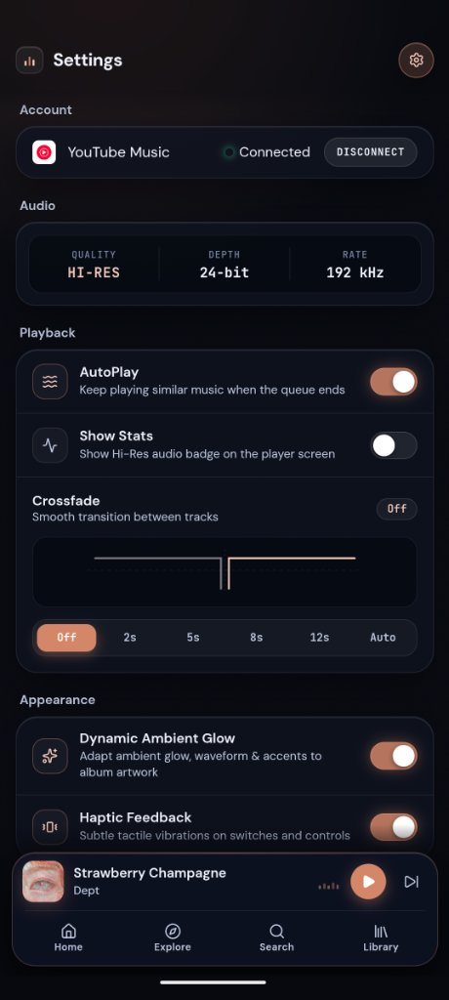
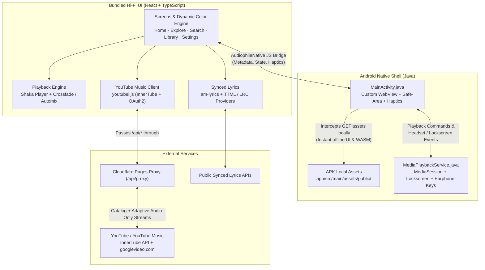

<div align="center">

# Audiophile

**Tactile Digital Hi-Fi — A bespoke, ad-free Android music streaming app powered by YouTube Music.**

[](./Audiophile.apk)
[](./web-ui)
[](./app/src/main/java/com/ren/audiophile/MediaPlaybackService.java)
[](./Audiophile.apk)

*Obsidian Acoustic Glass · Dynamic Album Ambient Engine · Luminous Waveform Scrubber · Synced Karaoke Lyrics · Native Android Media Controls*

</div>

---

## Screenshots

### Core Listening Experience

<div align="center">
  <table>
    <tr>
      <td align="center"><strong>Home — Listening Lounge</strong></td>
      <td align="center"><strong>Now Playing &amp; Synced Lyrics</strong></td>
      <td align="center"><strong>Cinema Stage — Artwork</strong></td>
      <td align="center"><strong>Cinema Stage — Lyrics</strong></td>
    </tr>
    <tr>
      <td></td>
      <td></td>
      <td></td>
      <td></td>
    </tr>
  </table>
</div>

### Discovery, Vault & Control Deck

<div align="center">
  <table>
    <tr>
      <td align="center"><strong>Explore — Discovery Crate</strong></td>
      <td align="center"><strong>Search — Acoustic Moods</strong></td>
      <td align="center"><strong>Library — Record Vault</strong></td>
      <td align="center"><strong>Settings — Control Deck</strong></td>
    </tr>
    <tr>
      <td></td>
      <td></td>
      <td></td>
      <td></td>
    </tr>
  </table>
</div>

---

## What Is Audiophile?

**Audiophile** is a personal Android music streaming app designed around a **Tactile Digital Hi-Fi** aesthetic—inspired by precision audio hardware (Bang & Olufsen, Teenage Engineering) and spatial glassmorphism rather than generic clone layouts.

Instead of static colors and cluttered menus, every screen adapts dynamically to the album artwork currently playing: shifting the top ambient radial glow, waveform playhead, active buttons, and glass borders in real time while keeping native Android ergonomics, lockscreen controls, and Bluetooth/earphone media keys effortless.

---

## Key Features

- **Dynamic Album Ambient Engine:** Extracts dominant and vibrant accent hues from the active track's artwork via a CORS-safe canvas pipeline, tinting the top radial glow, waveform scrubber, play/pause transport, and active controls (with a clean Cobalt/Ice-Blue fallback when idle or playing monochrome covers).
- **Unified Floating Sonic Dock:** Merges the interactive Mini-Player and 4 core destinations (**Home, Explore, Search, Library**) into a single Acoustic Glass capsule with a smooth bottom fade mask:
  - Live animated micro-waveform tinted to the current album.
  - **Swipe left / right** on the mini-player to skip tracks.
  - **Tap or swipe up** to reveal the full Now Playing sheet; **swipe down** to dismiss.
- **Luminous Acoustic Waveform Scrubber:** Deterministic 48-bar studio waveform silhouette with a glowing laser playhead needle and touch-accurate scrubbing.
- **Synced Word-by-Word Lyrics:** Powered by `@uimaxbai/am-lyrics` with smooth `0.7s` gradual depth blur and Cinema Stage full-screen mode.
- **Editorial Home ("Listening Lounge"):** Frameless Continue Listening Vinyl Stage with peeking vinyl disc & mini-waveform preview, 3-row numbered Quick Picks, asymmetric Bento clusters, and Vinyl Sleeve mood shelves.
- **Art-Directed Acoustic Mood Tiles (Search):** Eliminates text-heavy raw YouTube category thumbnails by extracting a heavy `blur(28px)` atmospheric color wash layered with custom geometric acoustic SVG patterns.
- **Record Vault (Library):** Segmented glass switcher (`Playlists`, `Songs`, `Recent`, `Artists`, `Albums`), 2-layer stacked record sleeve cards, glowing fallback art for Liked Music, and a smart **`Music Only`** toggle that moves non-music YouTube playlists (`Liked videos`, `Saved Shorts`) into a collapsible footer section.
- **Crossfade & Automix:** Interactive stepped crossfade selector (`Off`, `2s`, `5s`, `8s`, `12s`, `Automix`) with a live morphing SVG X-curve preview.
- **Native Android Integration:**
  - Foreground **`MediaPlaybackService`** with `MediaSessionCompat` and `Notification.MediaStyle` (lockscreen artwork, play/pause, next/prev, seek).
  - Full **Bluetooth & wired earphone button support** (`HEADSETHOOK`, `MEDIA_PLAY_PAUSE`, `MEDIA_NEXT`, `MEDIA_PREVIOUS`) + auto-pause on headphone unplug (`ACTION_AUDIO_BECOMING_NOISY`).
  - Native Android **Haptic Feedback** bridge (`AudiophileNative.haptic`) and zero-browser touch polish (no tap highlight flashes, no accidental text selection or zoom).

---

## How It Works (Architecture)

Audiophile uses an **Offline-Bundled Hybrid Android Architecture** combining a native Android foreground media service with a bundled React/TypeScript UI served directly from inside the APK.



### 1. Where Does the Music Come From & Why Are There No Ads?
- **Catalog & Audio Source:** Audiophile queries YouTube Music's internal **InnerTube API** via `youtubei.js` (routed through a lightweight CORS proxy at `/api/proxy`).
- **Ad-Free Playback:** On official YouTube clients, ads are not baked into the audio file—the official player explicitly fetches `adPlacements` and injects ad videos before or during playback. Audiophile resolves the **direct adaptive audio-only stream** (`AAC` / `Opus` from `googlevideo.com`) for each `videoId` and feeds it straight into `Shaka Player` / Web Audio without ever loading `adPlacements`.
- **Personal Account Sync:** Signing in uses **Google OAuth2** directly on the device to fetch your personal YouTube Music playlists, Liked Music, and listening history. Credentials stay local on your device.

### 2. Instant Offline Asset Loading + Native Media Controls
- When the app launches, `MainActivity.java` intercepts `GET` requests for UI bundles, fonts, CSS, and WASM models and serves them directly from `app/src/main/assets/public/` inside the APK—so the UI boots instantly without redownloading frontend assets.
- Only `/api/*` requests pass through to the network proxy.
- Whenever a track plays, pauses, or seeks, the UI notifies `window.AudiophileNative.updateMetadata(...)` and `updatePlaybackState(...)`, keeping Android's **`MediaPlaybackService`** lockscreen card and Bluetooth/earphone buttons perfectly synchronized.

### 3. Dynamic Color Engine & Cosmetic Audio Telemetry
- `src/lib/dynamicAccent.ts` samples a tiny 16×16 copy of the active track's artwork on an offscreen canvas, selects a vibrant mid-luminance hue in HSL space, clamps contrast for legibility on `#07090F`, and writes `--accent-rgb`, `--accent-hex`, `--accent-bright`, and `--ambient-rgb` onto `:root`. If a cover is monochrome or CORS-restricted, it gracefully falls back to signature Cobalt/Ice-Blue.
- The `HI-RES · 24-bit / 192 kHz` badge (when **Show Stats** is toggled on) is purely a cosmetic Hi-Fi visual indicator—the underlying stream remains YouTube Music's adaptive audio stream untouched.

---

## Installation (Android APK)

1. Download **[Audiophile.apk](./Audiophile.apk)** directly from this repository onto your Android phone.
2. Open the downloaded `.apk` file and allow **Install from unknown sources** if prompted.
3. Launch **Audiophile**, tap the top-right **Settings** icon, and sign in with **YouTube Music** (optional—guest browsing & playback also works immediately).

---

## Project Structure

```text
Audiophile/
├── Audiophile.apk                           # Pre-built installable Android APK
├── README.md                                # Project documentation & showcase
├── docs/
│   └── screenshots/                         # Real Android device screenshots
├── app/
│   ├── build.gradle                         # Android app Gradle config
│   └── src/main/
│       ├── AndroidManifest.xml              # Permissions & foreground service setup
│       ├── assets/public/                   # Compiled production UI bundle
│       ├── res/                             # Adaptive icons, notification drawables, themes
│       └── java/com/ren/audiophile/
│           ├── MainActivity.java            # WebView host, asset interceptor, safe-area & haptics
│           └── MediaPlaybackService.java    # Foreground MediaSession, notification & headset controls
└── web-ui/                                  # Isolated mobile-first React + TypeScript UI source
    ├── index.html
    ├── package.json
    └── src/
        ├── lib/
        │   ├── dynamicAccent.ts             # Artwork dynamic HSL color extractor
        │   ├── haptics.ts                   # Native Android haptic feedback bridge
        │   └── cleanTitle.ts                # Track title normalizer
        ├── shell/
        │   ├── AppShell.tsx                 # Dynamic radial ambient canvas & layout shell
        │   ├── AppTopBar.tsx                # Minimal contextual top bar + scroll fade
        │   ├── UnifiedSonicDock.tsx         # Floating Mini-Player + 4-tab dock with gestures
        │   ├── PlayerBar.tsx                # Now Playing deck & dynamic transport controls
        │   ├── WaveformScrubber.tsx         # 48-bar luminous waveform & laser playhead
        │   ├── SidePanel.tsx                # Acoustic Glass Lyrics & Up Next switcher
        │   └── FullScreenPlayer.tsx         # Cinema Stage full-screen artwork & lyrics
        ├── pages/
        │   ├── HomePage.tsx                 # Listening Lounge (Vinyl Hero, Quick Picks, Bento)
        │   ├── NewPage.tsx                  # Discovery Crate (Spotlight Carousel, Pulse Chart)
        │   ├── SearchPage.tsx               # Floating Search Lens & filter chips
        │   ├── LibraryPage.tsx              # Record Vault (Sleeves, Music Only filter)
        │   └── SettingsPage.tsx             # Account, Audio, Crossfade Curve & Appearance
        └── components/music/
            └── CategoryTiles.tsx            # Custom Acoustic Mood Tiles (zero text collision)
```

---

## Build From Source

### Prerequisites
- **Node.js 20+** and `npm`
- **JDK 21** and **Android SDK** (configured via `ANDROID_HOME` or `local.properties`)

### 1. Build the Mobile Web UI Bundle
```bash
cd web-ui
npm install
npm run typecheck
npm run build
```

### 2. Sync Bundle into Android Assets & Compile APK
```bash
# Copy compiled web-ui/dist/* into app/src/main/assets/public/
rm -rf app/src/main/assets/public/*
cp -r web-ui/dist/* app/src/main/assets/public/

# Build debug APK
./gradlew assembleDebug
```
The compiled APK will be generated at `app/build/outputs/apk/debug/app-debug.apk`.

---

## Disclaimer

This project is built strictly for **personal use, UI/UX craftsmanship, and educational portfolio purposes**. Audiophile is not affiliated with, endorsed by, or connected to YouTube, Google, or Apple Music. All music streams, artwork, and metadata belong to their respective copyright holders.
